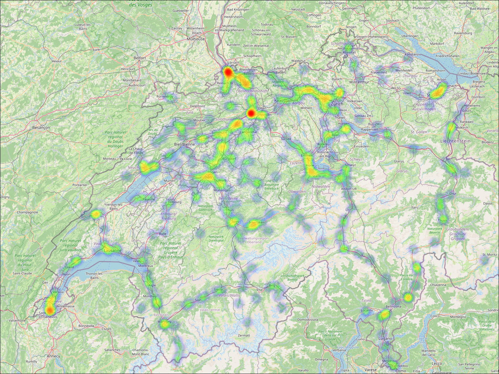
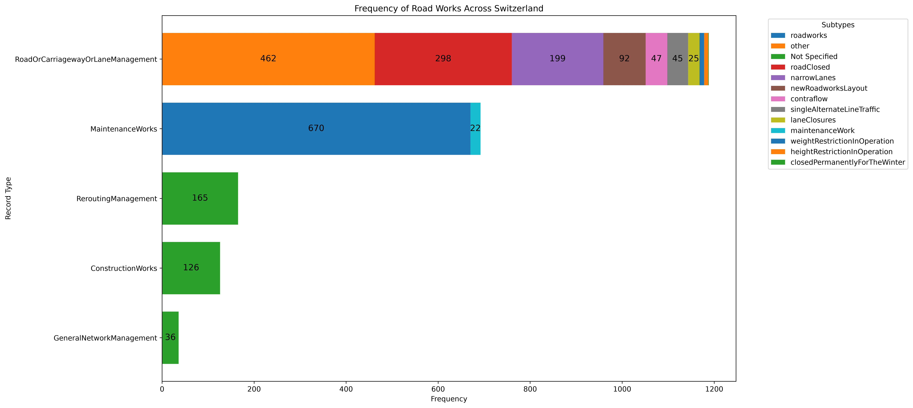

# Switzerland Road Traffic Analysis

Explore reported road works and traffic situations in Switzerland with an interactive map and a summary chart. The app downloads traffic data from OpenTransportData Swiss, combines it with Swiss TMC road-location files, stores the parsed records locally, and creates visual summaries.

## Results preview

The heatmap highlights locations with more reported road-work and traffic-management records. The chart compares record types and their reported subtypes. These are example previews; your results depend on the traffic data available when you run the app.





## Quick start: download a packaged app

Download the package for your computer from [GitHub Releases](https://github.com/AntonMalynevskyi/api_analyse/releases/latest):

| Computer | Package |
| --- | --- |
| Windows, 64-bit | `api-analyse-windows-x86_64.zip` |
| Linux, 64-bit | `api-analyse-linux-x86_64.zip` |
| macOS, Apple Silicon | `api-analyse-macos-arm64.zip` |

Extract the whole zip to a folder. Keep the executable together with its `_internal` folder, `data` folder, and `.env.example` file. The package includes a pre-downloaded traffic XML snapshot from OpenTransportData Swiss, as well as the TMC lookup files and SOAP request template under `data/raw`.

For the first run, open a terminal in the extracted folder and start the full pipeline:

```text
# Windows
api-analyse.exe showcase

# macOS or Linux
./api-analyse showcase
```

`showcase` processes the pre-downloaded snapshot included in the package, generates the results, and opens the app in your browser. This first run does not need an API key. The terminal window must remain open while the browser app is running; press Ctrl+C there to stop it.

### Download newer traffic data

To refresh the packaged snapshot, get an API key from [OpenTransportData Swiss](https://api-manager.opentransportdata.swiss/) and enable **Road traffic - traffic situations**. You can provide the key just for the download:

```text
api-analyse data download --api-key YOUR_API_KEY
```

On Windows, use `api-analyse.exe` in place of `api-analyse`.

Or save the key in `.env` to avoid typing it into the command each time. In the extracted app folder:

```text
# macOS or Linux
cp .env.example .env
nano .env
```

On Windows, copy `.env.example` to `.env` in File Explorer and open `.env` in Notepad. In either editor, replace the empty value with your key so the line looks like this, then save the file:

```dotenv
OPENTRANSPORTDATA_API_KEY=YOUR_API_KEY
```

Now run these commands from the extracted app folder (on Windows, use `api-analyse.exe` instead of `api-analyse`):

```text
api-analyse data download
api-analyse showcase
```

The same commands work from source when prefixed with `uv run`, for example `uv run api-analyse data download`. The database and generated results are local. Keep `.env` private and do not share it.

## Run from source

You need Python 3.12 or newer and [uv](https://docs.astral.sh/uv/).

```bash
git clone https://github.com/AntonMalynevskyi/api_analyse.git
cd api_analyse
uv sync
uv run api-analyse showcase
```

## Commands

| Command | What it does |
| --- | --- |
| `api-analyse showcase` | Uses traffic records already in the database, or loads the bundled snapshot if needed, generates both results, then opens the browser app. Does not require an API key for the bundled snapshot. |
| `api-analyse data` | Downloads the latest traffic data and loads the TMC road tables and traffic records into the local database. Requires an API key. |
| `api-analyse data download` | Downloads the latest traffic XML only. Uses the key in `.env` or accepts `--api-key YOUR_API_KEY`. |
| `api-analyse data load tmc` | Loads the bundled TMC road and location lookup tables. |
| `api-analyse data load traffic` | Parses the traffic XML file in `data/raw/traffic` and saves records to the database. |
| `api-analyse generate` | Generates the heatmap and chart from data already in the database. If needed, it can load the bundled traffic XML; if no local XML is available, it offers to download data. |
| `api-analyse generate heatmap` | Generates the heatmap only. |
| `api-analyse generate chart` | Generates the chart only. |

When using a packaged app, prefix commands with the executable name, such as `./api-analyse data` on macOS/Linux or `api-analyse.exe data` on Windows.

## Files and data

The app keeps its files beside the source checkout or packaged executable:

- `data/raw/traffic/traffic_situations.xml` — downloaded traffic feed.
- `data/raw/traffic/VM_request_body.xml` — request template used for the download.
- `data/raw/tmc/` — bundled Swiss TMC lookup tables.
- `data/processed/traffic_situations.db` — local SQLite database.
- `data/processed/switzerland_road_works_heatmap.html` — generated interactive map.
- `data/processed/switzerland_road_works_chart.webp` — generated chart.

The interactive map uses OpenStreetMap tiles, so it needs an internet connection when viewed. Downloading newer traffic data requires internet access and a valid API key. The database and generated results are local to the folder; deleting `data/processed` removes them, and they can be generated again.

## Data source

Traffic situations are retrieved from [OpenTransportData Swiss](https://opentransportdata.swiss/). Map tiles are provided by [OpenStreetMap](https://www.openstreetmap.org/copyright). The app is an analysis and visualization project; check the source service for current traffic information before travelling.
